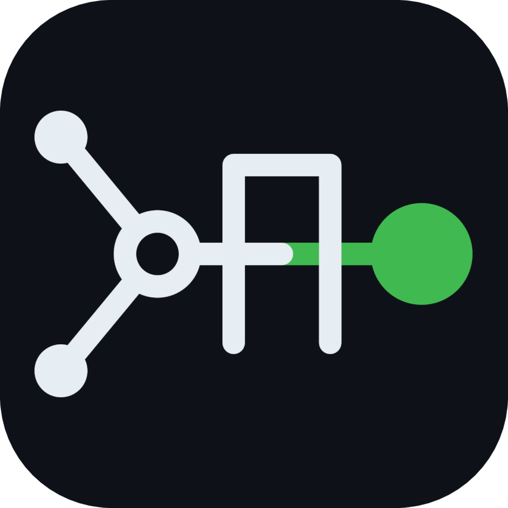
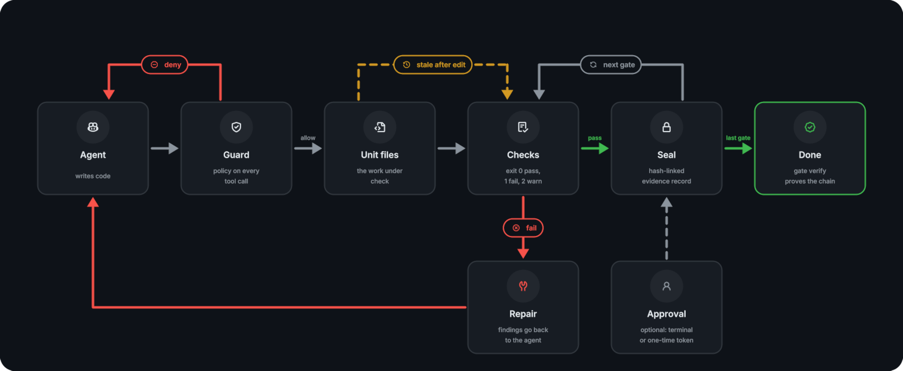

<div align="center">



# GateGraph

GateGraph decides when an AI coding agent's work counts as done.
The agent writes as it likes, but a gate opens only when deterministic checks pass.
Every opening is sealed into a hash-linked record that anyone can verify later, and editing a certified file makes its gate stale again.

[](https://github.com/landtml/gategraph/actions/workflows/ci.yml)
[](https://github.com/landtml/gategraph/actions/workflows/nightly.yml)
[](LICENSE)

[How it works](#how-work-moves-through-the-gates) · [Getting started](#getting-started) · [Docs](docs/README.md) · [Changelog](CHANGELOG.md)

</div>

When an agent marks its own work as finished, that claim rests on the model's
judgement of itself. GateGraph moves the judgement out of the model. You declare
the gates and their checks in one adapter file. The agent works inside them,
gets the findings back when a check fails, and tries again. The model stays the
same; what changes is what it has to show before it can move on.

## How work moves through the gates



Every change the agent tries to make goes through the guard first. The guard is
one function that sees each write, edit, shell command, network call and read
before the tool runs. It either allows the call or denies it with a reason the
agent can act on.

Allowed changes land in the unit's files. When the agent asks for a gate,
GateGraph runs that gate's checks as ordinary subprocesses. Exit code 0 is a
pass, 1 is a fatal failure and 2 is a warning. Any other code means the check
did not run, which is also fatal. A failing check sends its findings, as JSON
when the check emits them, back to the agent, which repairs the work and tries
again.

A pass seals the gate. The seal appends one record to the unit's evidence chain
with the gate's name, the digests of the files it certified, a digest of
each check that produced the result and the hash of the previous record. The chain is projected to
`evidence.jsonl` and `manifest.yaml`. Then the next gate is attempted. A gate
can also wait for a person to approve it, either at the terminal or with a
one-time token, of which only the sha256 is stored.

The record stays honest after the fact. If someone edits a file that a gate
certified, that gate and the gates that depend on it go stale until they are
earned again. When the last gate has passed, `gate verify` walks the whole
chain and checks every hash.

## What you configure

Everything specific to a project lives in `harness/adapter/adapter.yaml`. It
declares the gate chain, the checks attached to each gate and a `policy:` block
of `deny` regexes, `ask` paths, `protected_paths` and `blind` paths, which
`core/kernel/guard.py` enforces. Only two commands can move a gate: `gate
attempt` runs its checks and `gate proceed` answers an approval.

Verifiers and domain packs are optional. A verifier is a blinded model call that
scores an artifact against a rubric. A domain pack bundles the readers, checks,
rubrics and tool grants for one kind of work, and the repository ships packs
for `code`, `document`, `research`, `data` and `ops`.

The kernel uses only the standard library and PyYAML, so the hooks run on the
system Python. The graph layer, which provides LangGraph checkpoints, interrupts
and fan-out, runs in a hash-locked virtual environment. Its limits and attack
surface are written up in [docs/THREAT-MODEL.md](docs/THREAT-MODEL.md).

## Getting started

Clone the repository, build the virtual environment once and run the core
tests:

```sh
git clone https://github.com/landtml/gategraph
cd gategraph
make venv && make test-core
```

Then stamp a project. The plain form asks a few questions first, `--defaults`
accepts every default, and `--retrofit` adds GateGraph to an existing
repository without overwriting anything:

```sh
python3 gategraph.py init ../my-project
python3 gategraph.py init ../my-project --defaults
python3 gategraph.py init ../my-project --retrofit
```

A stamped project gets `harness/core/`, which `gategraph update` keeps in sync,
and `harness/adapter/adapter.yaml` for your own rules. It also gets Claude Code
hooks in `.claude/settings.json` and a `make check` target that decides when
work is done.

Inside the project, a unit of work is driven with the `gate` command:

```sh
GATE=".venv/bin/python harness/core/cli/gate.py"
$GATE start   --unit my-feature           # create the unit and run to the first request
$GATE attempt <gate> --unit my-feature    # try a gate; prints the findings on failure
$GATE status  --unit my-feature           # where the unit is and the next command
$GATE verify  --unit my-feature           # check the evidence chain
```

<details>
<summary>Every gate command</summary>

```sh
$GATE start    --unit <slug>
$GATE attempt  <gate> --unit <slug>
$GATE status   --unit <slug>
$GATE pending  --unit <slug>                     # open work, approval or escalation requests
$GATE proceed   --unit <slug> --decision <d> --by <name> [--note <text>] [--token <t>]
$GATE pause    --unit <slug>
$GATE escalate --unit <slug> --note <text>
$GATE abandon  --unit <slug> [--by <name>] [--note <text>] [--token <t>]
$GATE verify   --unit <slug>                     # read only
$GATE archive  --unit <slug>                     # delete checkpoints of a finished unit
```
</details>

<details>
<summary>Every stamper command</summary>

```sh
python3 gategraph.py add-check <dir> --id <id> --cmd "<command>" --gate <gate> [--on "<glob>"] [--severity fatal|warn]
python3 gategraph.py set-gate-checks <dir> <gate> <check> [<check> ...]
python3 gategraph.py gen <dir>        # regenerate generated doc blocks
python3 gategraph.py diff <dir>       # report core drift
python3 gategraph.py update <dir>     # sync pristine core files
python3 gategraph.py upstream <dir> <file>
python3 gategraph.py migrate <dir>    # move a 0.4 project to 0.5, see docs/MIGRATION.md
```
</details>

## Tests and evaluation

`make check` is the release gate. It runs the tests, the self-lint, the golden
scenarios and the deterministic evaluation, and it makes no model calls.

```sh
make check        # release gate, no model calls
make test         # every core layer plus end-to-end stamping tests
make eval         # deterministic corpus, expected 220/220
```

Each layer also has its own target: `test-kernel`, `test-hosts`, `test-graph`,
`test-compat`, `test-tools`, `test-agent`, `test-packs`, `test-search` and
`test-eval`.

## Repository layout

```text
gategraph.py      stamper: init, update, diff, upstream, gen, add-check, set-gate-checks, migrate
core/kernel/      decisions, evidence, verification, config (stdlib + PyYAML)
core/graph/       LangGraph unit and search graphs
core/agent/       native agent loop with guard and budget middleware
core/tools/       agent tools with declared effects
core/hosts/       host bridge and Claude Code hook shims
core/cli/         gate and search commands
core/packs/       reference domain packs
core/eval/        measurement code
eval/             corpus and eval pack
seed/             adapter starters rendered at init
docs/             design, adapter guide, threat model, migration, rebuild plan, artwork
```

## Requirements

GateGraph needs Python 3.11 or newer, and CI runs every version from 3.11 to
3.14. It runs on Linux and macOS, and on Windows through WSL. The graph layer
pins `langgraph` 1.2.21, `langgraph-checkpoint-sqlite` 3.1.3, `langchain` 1.5.0
and `langchain-core` 1.8.0 with hashes in `core/requirements.lock`, so `make
venv` needs the network once.

Some dependencies are not included. `langgraph-api` is under the Elastic
License, and LangSmith tracing and Postgres are not used. The `privacy: strict`
setting needs `pycryptodome`, which is not in the lock file yet.

## Status

The current version is `0.5.0-dev`, rebuilt on LangGraph. Projects stamped by
0.4 keep working through a schema-1 translator and compatibility shims; the
details are in [CHANGELOG.md](CHANGELOG.md) and
[docs/MIGRATION.md](docs/MIGRATION.md). Interfaces may change before 1.0.

The artwork in this README is rendered in Blender from
[docs/assets/render.py](docs/assets/render.py).

## License

MIT © 2026 landtml. See [LICENSE](LICENSE).

---

<sub>This project was previously called Gatebench.</sub>
